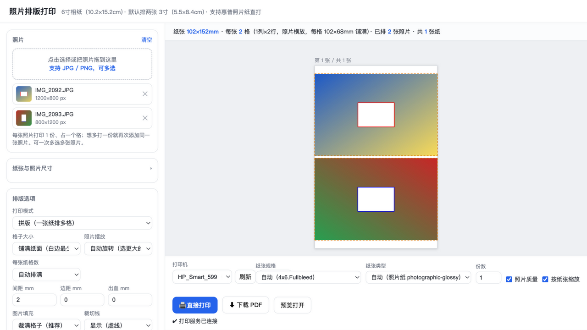

# 照片排版打印系统 / Photo Layout & Print Studio

在 macOS 上一键排版、打印照片的本地小工具：**6 寸相纸自动排两张 3 寸**，也支持 A4 拼版、单张满幅、证件照等多种排版，通过惠普（HP）打印机自动选择照片纸直打，带打印队列管理。纯前端 + Python 标准库，**零第三方依赖**。

A local photo-layout & printing studio for macOS: auto-fit two 3-inch photos on a 4×6" sheet, A4 layouts, borderless full-bleed prints, and a print-queue manager for HP printers. Vanilla HTML/JS + Python stdlib only — no third-party dependencies.



## 功能特性

- **两种打印模式**
  - **拼版**：一张纸排多格，格子大小可选「铺满纸面（白边最少）/ 占纸 2/3 / 标准冲印尺寸」
  - **单张6寸**：一纸一照满幅无边框；横版照片自动在页内旋转，规避惠普固件处理横页只渲染一半的缺陷
- **智能排版引擎**
  - 格子方向自动跟随照片方向；「自动旋转」会同时尝试正放/旋转 90°，取能印得更大的方案
  - 多张照片按顺序填格、自动分页，每张照片打印 1 份
  - 可调：纸张尺寸（6寸/5寸/7寸/A4/A6/自定义）、格数、间距、边距、出血、裁切线
- **打印参数自动联动**：选照片纸 → 自动携带对应规格 + 照片纸类型（photographic）+ 照片质量；选 A4 → 自动切换 A4 规格 + 普通纸类型
- **打印队列管理**：查看待打印任务（文件名、序号、打印中/排队中、用时），单条取消或一键取消全部
- **三种出图方式**：直接打印 / 下载精确物理尺寸 PDF / 预览打开手动打印
- **文件完整性校验**：拒绝传输中断的 JPEG/PNG（避免打印出白色虚影）

## 快速开始

```bash
# macOS 自带 Python 3，无需安装任何依赖
git clone https://github.com/jianhaiyu-dot/photo-layout-printer.git
cd photo-layout-printer
python3 server.py          # 或双击 启动.command（自动打开页面，关窗即停）
```

浏览器打开 <http://127.0.0.1:8791>，把照片拖进左侧列表即可。

## 打印说明

- 打印机里放好对应相纸；「纸张规格/纸张类型」保持「自动」即可（已按所选相纸自动联动）
- 想要无边框：纸张规格选 `4x6.Fullbleed`（惠普驱动自带）
- 打印进度百分比受 macOS CUPS 限制无法获取，队列面板会显示「打印中 · 已用时长」替代

## 目录结构

```
├── index.html      # 排版界面 + 排版引擎 + PDF 生成（纯 JS，页面为精确物理尺寸）
├── server.py       # 本地服务：队列查询/取消、lp 直打（仅标准库）
├── 启动.command     # 双击启动（关窗即停）
└── 使用说明.md      # 详细使用文档
```

## 技术说明

- PDF 由前端纯 JS 生成（自研写入器），页面 MediaBox 为精确物理尺寸（如 102×152mm），图片按 300 DPI 重采样后以 DCTDecode 内嵌
- 打印走 CUPS：`lp` 提交（任务标题携带文件名）+ `lpstat` 队列查询 + `cancel` 取消；打印参数自动探测 `lpoptions`
- 全程本地运行，照片不上传任何服务器

## License

[MIT](LICENSE)
